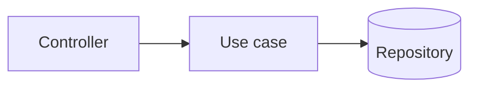

# Write your slides

A presentation is a **folder** with a Markdown file named `slides.md` at its root, and the images
it uses:

```text
my-talk/
├── slides.md
└── assets/
    ├── architecture.svg
    └── logo.png
```

Any folder name works. A `slides.md` in a subfolder does not count: choose the folder that holds it.
If you want a model, **Load the example** on the home screen opens a short talk you can read as a
guide; its files are the ones described here.

## Slides

A line with three dashes alone ends a slide:

```markdown
# First slide

Some text.

---

## Second slide

- a list
- of points
```

To draw a horizontal rule inside a slide, write `***` or `___`. Three dashes inside a fenced code
block are code, not a separator.

The slide supports GitHub-flavoured Markdown: headings, emphasis, lists, task lists, tables, quotes,
links, inline code and fenced code. The first heading of a slide (level 1 to 3) is its title in the
overview, and its first paragraph is its description.

## Settings at the top of the file

An optional block of YAML at the very top, between two lines of three dashes:

```markdown
---
title: Hexagonal architecture
description: Tactical patterns and architecture tests
author: Your name
theme: dark
ratio: fixed
---
```

| Setting       | Values            | Default | What it does                                                   |
| ------------- | ----------------- | ------- | -------------------------------------------------------------- |
| `title`       | text              | none    | The title of the window and of the presenter window.           |
| `description` | text              | none    | For you; it is not shown.                                      |
| `author`      | text              | none    | For you; it is not shown.                                      |
| `theme`       | `light` or `dark` | `dark`  | The look of the slides. It does not depend on the app's theme. |
| `ratio`       | `fixed` or `auto` | `fixed` | `fixed` keeps the 16:9 frame; `auto` fills the window.         |

If the block is not valid YAML, Slides says so and tells you what it found; fix it or remove it.

## Notes

Two kinds of notes, written as blocks closed by three colons. They are taken out of the slide:

```markdown
## Ports and adapters

The domain depends on nothing.

:::notes-presenter
Ask who already uses it. Budget: five minutes.
:::

:::notes-public
Reference: the book, chapter 4.
:::
```

- `:::notes-presenter` is shown in the **presenter window** only.
- `:::notes-public` is shown in the presenter window and **printed** under the slide.

Several blocks of one kind on a slide are joined, in order. Notes are Markdown too.

## Code

A fenced block with a language is highlighted for `java`, `javascript` (`js`), `typescript` (`ts`),
`json` and `yaml` (`yml`). Any other language is shown as plain code.

````markdown
```java
public interface AccountRepository {
    Optional<Account> findById(AccountId id);
}
```
````

## Diagrams

A fenced block in the `mermaid` language is drawn as a diagram, in the theme of the slides:

````markdown

````

If a diagram cannot be drawn (a typo in its code, for instance), the slide shows a message and keeps
the code, and the other diagrams are still drawn. The first diagram of a session loads the drawing
library, which takes a moment the first time. Offline, diagrams work once a presentation with a
diagram has been shown online on this browser (see [offline](privacy-and-offline.md#offline)).

## Images

Put the images in the folder and refer to them by their path from the folder, with Markdown or HTML:

```markdown

```

PNG, JPEG, GIF, WebP and SVG are supported. Spaces in a path can be written `%20`. An image that is
**not** in the folder is replaced by a note that says why: see
[what is blocked](privacy-and-offline.md#what-is-blocked).

## HTML in a slide

Plain HTML (`<div>`, `<br>`, `<sup>`...) works, but it is cleaned before it is shown: scripts, event
handlers, forms, frames, `style` attributes and addresses such as `javascript:` are removed. Use the
theme and Markdown for the look of your slides.
