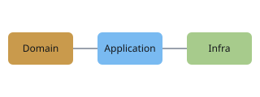
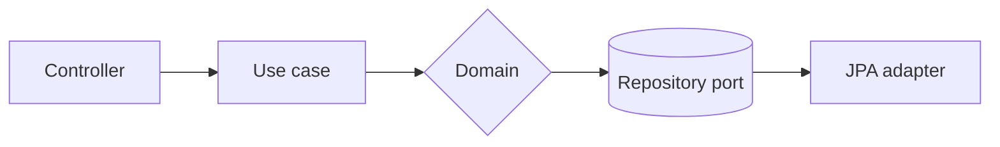

# Hexagonal architecture

Tactical patterns, explicit boundaries and architecture tests for Java services that stay
maintainable.

:::notes-presenter
Opening slide. Ask who already practises hexagonal architecture.
Announce the plan: domain, ports, ArchUnit tests.
:::

:::notes-public
Workshop handout, internal version.
:::

---

## The layers

The domain depends on nothing. The application orchestrates. The infrastructure implements the
ports.



:::notes-presenter
Insist: the dependency arrow always points to the domain.
:::

---

## A port and its adapter

```java
public interface AccountRepository {
    Optional<Account> findById(AccountId id);
    void save(Account account);
}
```

The port lives in the domain; the JPA adapter lives in the infrastructure.

---

## Flow of a command



:::notes-presenter
Show that the use case only knows the port, never the adapter.
:::

---

## Testing the boundaries with ArchUnit

| Rule                                     | Checks                   |
| ---------------------------------------- | ------------------------ |
| Domain without infrastructure dependency | Isolation of the core    |
| `@Transactional` outside the domain      | Transaction anti-pattern |
| Ports in the right package               | Structure convention     |

```java
@ArchTest
static final ArchRule pureDomain =
    noClasses().that().resideInAPackage("..domain..")
        .should().dependOnClassesThat().resideInAPackage("..infra..");
```

:::notes-public
ArchUnit runs like any JUnit test.
:::

---

## Take away

- Dependencies point to the domain.
- Ports belong to the domain, not the other way round.
- Architecture tests make the rules **executable**.

:::notes-presenter
Conclude and open for questions. Time budget: 45 minutes.
:::
