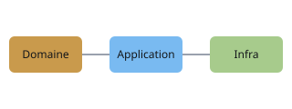
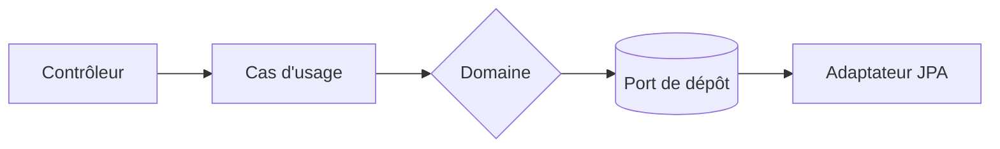

# Architecture hexagonale

Patterns tactiques, frontières explicites et tests d'architecture pour des services Java
maintenables.

:::notes-presenter
Slide d'ouverture. Demander qui pratique déjà l'architecture hexagonale.
Annoncer le plan : domaine, ports, tests ArchUnit.
:::

:::notes-public
Support de l'atelier, version interne.
:::

---

## Le découpage en couches

Le domaine ne dépend de rien. L'application orchestre. L'infrastructure implémente les ports.



:::notes-presenter
Insister : la flèche de dépendance pointe toujours vers le domaine.
:::

---

## Un port et son adaptateur

```java
public interface AccountRepository {
    Optional<Account> findById(AccountId id);
    void save(Account account);
}
```

Le port vit dans le domaine ; l'adaptateur JPA vit dans l'infrastructure.

---

## Flux d'une commande



:::notes-presenter
Montrer que le cas d'usage ne connaît que le port, jamais l'adaptateur.
:::

---

## Tester les frontières avec ArchUnit

| Règle                                         | Vérifie                     |
| --------------------------------------------- | --------------------------- |
| Domaine sans dépendance vers l'infrastructure | Isolation du cœur métier    |
| `@Transactional` hors du domaine              | Anti-pattern transactionnel |
| Ports dans le bon paquet                      | Convention de structure     |

```java
@ArchTest
static final ArchRule domainePur =
    noClasses().that().resideInAPackage("..domaine..")
        .should().dependOnClassesThat().resideInAPackage("..infra..");
```

:::notes-public
ArchUnit s'exécute comme un test JUnit classique.
:::

---

## À retenir

- Les dépendances pointent vers le domaine.
- Les ports appartiennent au domaine, pas l'inverse.
- Les tests d'architecture rendent les règles **exécutables**.

:::notes-presenter
Conclure et ouvrir aux questions. Budget : 45 minutes.
:::
