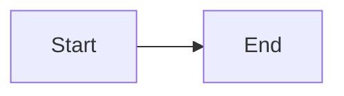

# First

Opening sentence.

:::notes-presenter
Say hello.
:::

:::notes-public
Printed note one.
:::

---

## Second


---

## Third

```yaml
a: 1
---
b: 2
```

---

## Fourth



:::notes-public
Printed note four.
:::
