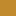

# Hostile slide

[markdown link](javascript:window.__pwned='link')

<a href="JaVaScRiPt:window.__pwned='link2'" onclick="window.__pwned='click'">mixed case</a>

overlay

<iframe src="https://example.com/frame"></iframe>

<form action="https://evil.example/post"><input name="x"><button>Send</button></form>

<svg onload="window.__pwned = 'svg'"></svg>

[a safe link](https://example.org/page)

:::notes-presenter
Careful notes.
:::

---

# Second slide

Nothing to see.
